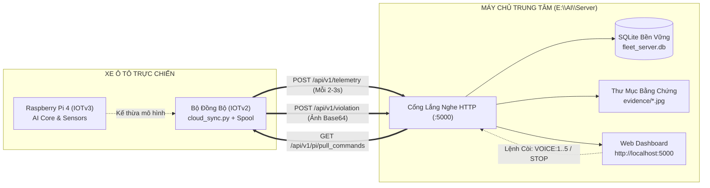

# MÁY CHỦ TIẾP NHẬN & QUẢN LÝ DỮ LIỆU XE TRUNG TÂM (FLEET MANAGEMENT SERVER)

> **Vị trí**: `E:\AI\Server`  
> **Môi trường vận hành**: Máy tính PC (Windows / Linux) hoặc Máy chủ Đám mây (Cloud Server)  
> **Nhiệm vụ cốt lõi**: Trở thành Trung tâm Điều hành Tiếp nhận (Ingestion Hub) tiếp nhận toàn bộ dữ liệu từ xe (Raspberry Pi 4 / ESP32) gửi về, trực quan hóa trên Web Dashboard và phát lệnh điều khiển ngược xuống xe.

---

## 1. MỐI QUAN HỆ VỚI IOTv2 VÀ IOTv3



- **`IOTv3`**: Bản chạy trực tiếp trên xe ô tô (Raspberry Pi 4 ARM64 + Camera RTSP + ESP32 + GPS). Đảm nhận nhận diện buồn ngủ, ngáp, mất tập trung bằng AI và đọc cảm biến nồng độ khí CO2 khoang lái.
- **`IOTv2`**: Chuyên trách tầng viễn thông xe (`cloud_sync.py`), hàng đợi ngoại tuyến SQLite (`remote_sync.db`), tự động gửi bù khi có mạng.
- **`Server` (`E:\AI\Server`)**: Đóng vai trò là **Máy Chủ Đích Đến (Destination Server / Server Bạn Tôi)** tiếp nhận toàn bộ dữ liệu xe từ `IOTv3` và `IOTv2`.

---

## 2. DỮ LIỆU TIẾP NHẬN TỪ XE

Hệ thống tiếp nhận đầy đủ 8 nhóm thông tin từ Pi gửi về:
1. **Thông tin xe & Truy cập:** Tên xe, ID xe (`XE-01`), Tên tài xế, Địa chỉ IP mạng LAN của xe, Cổng Web xe (`8080`), Link mở bảng điều khiển Pi, Link xem trực tiếp video stream camera từ xa.
2. **Hệ thống Camera & AI:** Trạng thái Camera (`ONLINE/OFFLINE`), tốc độ xử lý AI FPS, độ phân giải khung hình, độ trễ xử lý.
3. **Cảm biến ESP32 & Khí MQ-135:** Nồng độ khí CO2 cabin xe (`co2_ppm`), giá trị ADC thô, cấp độ cảnh báo (`0: An toàn`, `1: Bí khí`, `2: Nguy cấp`), trạng thái kết nối cổng Serial UART.
4. **Định vị GPS 3D:** Tọa độ GPS (`lat`, `lon`), cao độ (`alt_m`), vận tốc xe (`speed_kmh`), số vệ tinh GNSS và nguồn định vị (`gps_satellite` ngoài trời hoặc `server_xyz` trong hầm/gara).
5. **Chỉ số Sinh học Tài xế:** Tỷ lệ mở mắt (EAR), độ mở miệng (MAR), góc nghiêng đầu 3D (Pitch, Yaw, Roll), phân loại vi phạm (`NORMAL`, `DROWSY`, `YAWNING`, `DISTRACTED`).
6. **Loa Cảnh Báo Tiếng Việt:** Lệnh giọng nói đang phát (`VOICE:1..3`, `STOP`), âm lượng, trạng thái phát còi.
7. **Sức Khỏe Phần Cứng Pi 4:** Nhiệt độ chip SoC (°C), RAM tiêu thụ (MB), % CPU, cảnh báo sụt áp nguồn xe tẩu sạc (`throttled`).
8. **Ảnh Chụp Bằng Chứng Vi Phạm:** Ảnh chụp JPEG sắc nét tại thời điểm tài xế vi phạm, tự động giải mã từ Base64 và lưu vào thư mục `evidence/`.

---

## 3. HƯỚNG DẪN KHỞI CHẠY MÁY CHỦ (1-CHẠM)

Bạn có 2 lựa chọn khởi chạy cực kỳ tiện lợi:

### 🌟 Lựa chọn 1: Chạy Bản Chẩn Đoán & Giám Sát Trực Tiếp (Khuyên dùng khi kiểm thử với Pi)
```bash
python server.py
```
- Tự động kiểm tra mạng LAN, cổng 5000, cổng SSH Pi (22), cổng Web Pi (8080).
- Tự động mở bộ thu UDP 5005 để Raspberry Pi tự dò IP máy tính khi đổi Wi-Fi.
- Hiển thị trực tiếp log từng nhịp Telemetry (GPS, CO2, ESP32) ngay trên Terminal.
- Mở Web Dashboard tại: **http://localhost:5000** (hoặc `http://<IP_PC>:5000`).

### 📦 Lựa chọn 2: Chạy Bản Quản Lý Hạm Đội Bền Vững (Lưu trữ SQLite & File ảnh)
```bash
python run_server.py
```
- Tự động lưu toàn bộ lịch sử vi phạm và telemetry vào cơ sở dữ liệu SQLite (`data/fleet_server.db`).
- Tự động trích xuất ảnh vi phạm Base64 ra thư mục file ảnh thật (`evidence/*.jpg`).
- Hỗ trợ phát lệnh điều khiển ngược xuống xe (`VOICE:1..3`, `STOP`).
- Mở Web Dashboard tại: **http://localhost:5000**.

---

## 4. HƯỚNG DẪN CẤU HÌNH TRÊN XE RASPBERRY PI 4

Trên bo mạch Raspberry Pi 4 (`IOTv2` hoặc `IOTv3`), mở file cấu hình môi trường:
`AI/deploy/pi.env`:
```ini
# Bật tính năng đồng bộ về Máy Chủ Trung Tâm
REMOTE_SERVER_ENABLED=1

# Điền địa chỉ IP của máy tính PC đang chạy E:\AI\Server (Ví dụ IP PC là 192.168.1.133)
REMOTE_SERVER_URL=http://192.168.1.133:5000

# Đặt mã định danh xe
VEHICLE_ID=XE-01
VEHICLE_NAME="Xe Bán Tải Nghiên Cứu"
DRIVER_NAME="Tài xế Nguyễn Văn A"
```

Khởi động lại dịch vụ giám sát trên Pi:
```bash
sudo systemctl restart driver-monitor
```
Ngay lập tức, toàn bộ dữ liệu di chuyển, nồng độ khí CO2 và ảnh chụp vi phạm trên xe sẽ hiển thị trực tiếp trên Dashboard của Máy Chủ!

---

## 5. KIỂM THỬ KẾT NỐI TỰ ĐỘNG

Trong thư mục `E:\AI\Server\tests`, có sẵn script mô phỏng xe Pi 4 gửi dữ liệu về server để bạn kiểm thử ngay lập tức mà không cần cắm bo mạch thật:
```bash
python tests/test_client_send.py --url http://127.0.0.1:5000
```

---

## 6. DANH SÁCH REST API CHUẨN HÓA

| Giao thức & Endpoint | Chi tiết chức năng | Người gọi |
|:---|:---|:---:|
| `POST /api/v1/telemetry` | Nhận chuỗi nhịp tim cảm biến, GPS, phần cứng định kỳ 2-3s | Pi 4 |
| `POST /api/v1/violation` | Nhận sự kiện vi phạm an toàn kèm ảnh JPEG Base64 | Pi 4 |
| `GET /api/v1/pi/pull_commands` | Xe kéo các lệnh điều khiển còi/loa đang chờ từ máy chủ | Pi 4 |
| `GET /api/v1/server/fleet` | Trả về danh sách xe trong hạm đội và trạng thái Online/Offline | Web UI |
| `GET /api/v1/server/violations`| Trả về danh sách nhật ký các sự kiện vi phạm gần nhất | Web UI |
| `POST /api/v1/server/command` | Người điều hành phát lệnh còi (`VOICE:1..3`, `STOP`) xuống xe | Web UI |
| `GET /evidence/<filename>` | Tải và xem ảnh chụp bằng chứng vi phạm JPEG độ nét cao | Trình duyệt |
| `GET /health` | Kiểm tra trạng thái sống của Server | Mạng |
